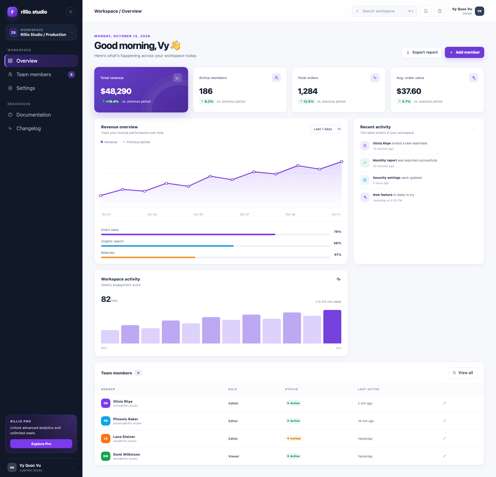
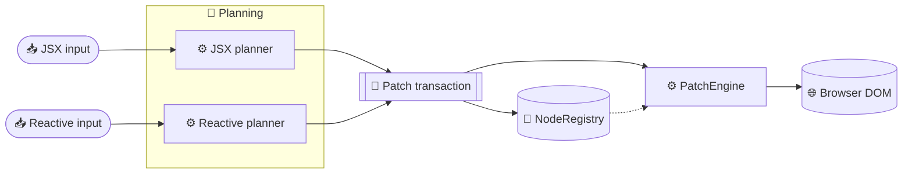

# Rillio

Rillio is an experimental addressable-DOM runtime for client-side apps. JSX and explicit reactive views share one Flat Index and one transactional `PatchEngine`.

<p align="center">
  
</p>
<p align="center"><em>Rillio Studio dashboard built with the Rillio runtime.</em></p>

## 🚀 Quick start

Install the published package in an existing app:

```sh
npm install rillio
```

Or clone the repository to run the examples locally:

```sh
git clone https://github.com/vyquocvu/rillio.git
cd rillio
npm install
npm run dev
```

Open `http://127.0.0.1:5173/` for the Rillio landing page, then follow its links to the showcases and docs.

## ⚛️ JSX runtime

```tsx
import { createRoot, useState } from "rillio";

function Counter() {
  const [count, setCount] = useState(0);
  return <button onClick={() => setCount(value => value + 1)}>{count}</button>;
}

createRoot(document.getElementById("app")!).render(<Counter />);
```

Configure TypeScript with `jsx: "react-jsx"` and `jsxImportSource: "rillio"`.

## 🧰 API surfaces

| Import | Use |
|---|---|
| `rillio` | JSX runtime, `createRoot`, and component hooks |
| `rillio/reactive` + `rillio/dom` | Reactive stores and mount-once DOM bindings such as `select`, `Show`, and `For` |

See the [API contract](docs/API.md) for usage and behavior details.

## 🧭 Architecture

Both planners turn JSX or reactive updates into addressable operations. A shared transaction validates and applies them through the Flat Index and `PatchEngine`.



- `NodeRegistry` is the source of truth for node identity, ownership, and parent/sibling structure.
- `PatchEngine` is the only module that writes to the browser DOM.
- Transactions validate operations, commit changes, then dispose removed subtrees.

Read the [architecture guide](docs/ARCHITECTURE.md) and [architecture diagrams](docs/diagrams/README.md) for the full design.

## 🧪 Examples

Run `npm run dev`, then open:

| Page | What it shows |
|---|---|
| `/` | Rillio landing page with an interactive code sample and counter |
| `/admin.html` | Rillio Studio dashboard |
| `/realworld.html` | TaskFlow workspace with a Kanban board and issue views |
| `/demos.html` | Interactive demo catalog |
| `/benchmarks.html` | Keyed-list benchmarks in the current browser |
| `/docs.html` | Browser-friendly documentation index |

The [examples guide](docs/EXAMPLES.md) covers the labs and benchmark commands.

## 🛠️ Development

```sh
npm run typecheck
npm test
npm run build:release
npm run test:consumer
npm run test:browser
npm run bench:all
npm run bench:browser
```

Documentation: [performance](docs/PERFORMANCE.md) · [testing](docs/TESTING.md) · [status](docs/STATUS.md) · [roadmap](ROADMAP.md).

## ⚠️ Scope

Rillio targets small client-side browser apps. JSX syntax is familiar, but React and Preact behavioral, scheduling, event, and ecosystem compatibility are not promised. SSR and hydration are out of scope. See the [API contract](docs/API.md) and [current status](docs/STATUS.md) for limitations.
