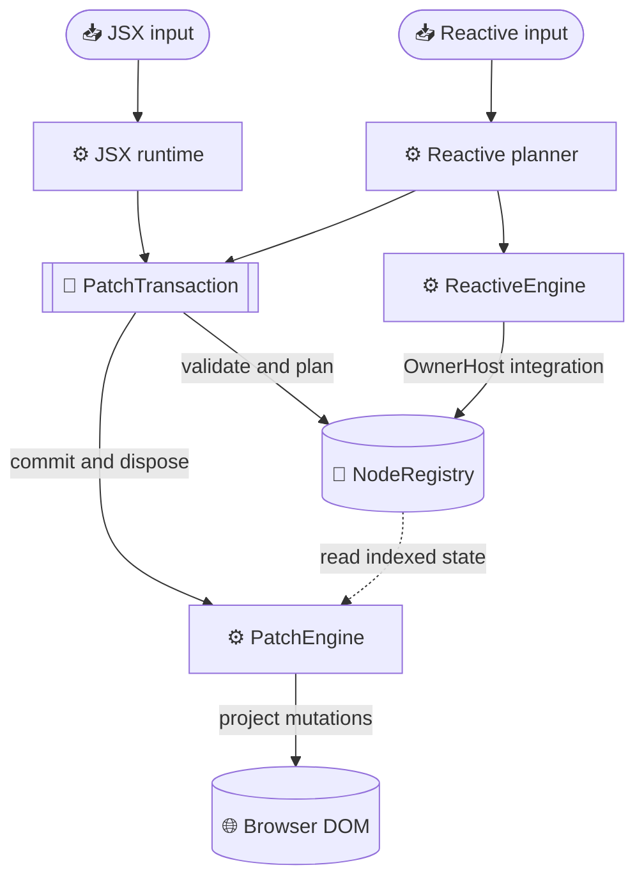
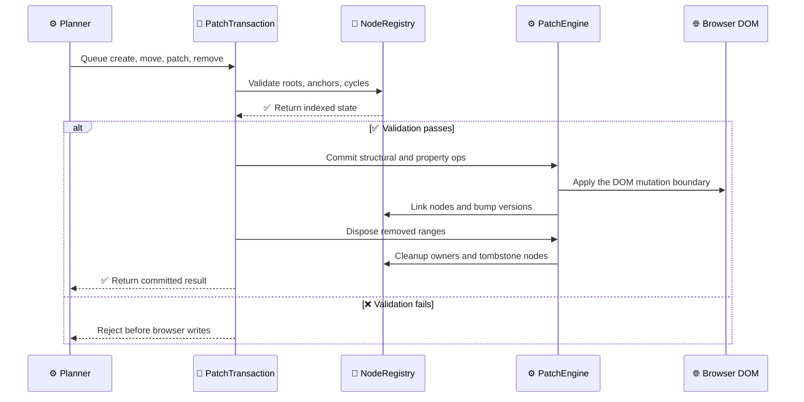
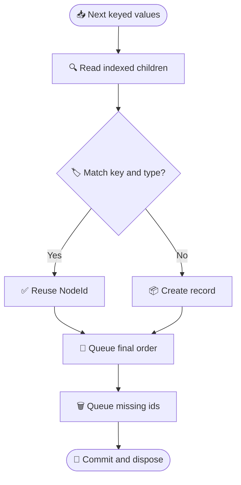
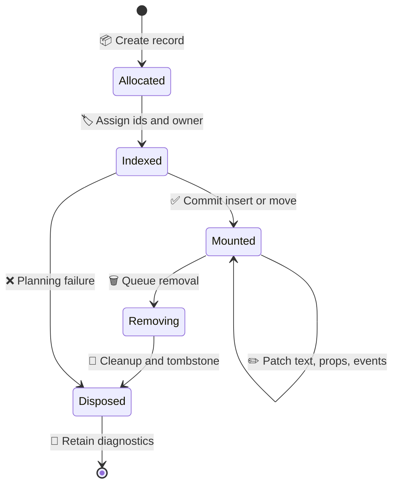

# Addressable DOM architecture

## Core invariant

The Flat Index is the only source of truth for rendered node identity, parent/sibling structure, ownership, and lifecycle. The browser DOM is a projection of that index. Render planners may keep temporary maps while planning a transaction, but they must not retain an authoritative child tree.

The two public planning surfaces are:

- the JSX component runtime in `src/compat.ts`, which reruns a component for hook state updates;
- the explicit reactive surface in `src/dom.ts`, which mounts a subtree once and binds reactive text, properties, regions, and list items.

They share the same `NodeRegistry`, `PatchEngine`, DOM operation helpers, and owner host. They are not independent DOM mutation implementations.

## Flat Index records

Each indexed record has:

- monotonic `NodeId`;
- `RootId` and `OwnerId`;
- `version`, incremented on structural, metadata, property, event, and lifecycle changes;
- node kind: root, element, text, comment, or boundary;
- DOM start/end boundary nodes;
- `parentId`, `prevSibling`, `nextSibling`, `firstChild`, and `lastChild`;
- key, type, props/value metadata, listeners, ref, and cleanup state.

Parent/sibling links are stored in the registry. `children(parentId)` walks those links and checks the index invariants. Components and structural regions use two comment nodes as one addressable boundary record, so their children are still indexed without a second virtual tree.

`RootId` and `OwnerId` are never reused. Disposed records remain as tombstones for diagnostics, while active traversals reject disposed records.

The registry keeps two related graphs: solid links describe DOM/index structure, while dashed links describe owner nesting. A node can move in the structure graph without changing its stable `NodeId` or its owner.

## Transaction lifecycle

All browser writes go through `PatchEngine`:

1. A planner creates addressable records and queues operations in a `PatchTransaction`.
2. Validation checks root membership, node state, parent/anchor validity, cycles, duplicate operations, and operation-kind constraints.
3. Commit inserts or moves ranges, patches text/properties/events/refs, and updates the Flat Index.
4. Remove operations run after structural/property changes. The engine clears bindings, runs cleanup, and disposes removed records.
5. Planning failures discard newly created records. Commit failures remove newly inserted ranges where possible and preserve the original exception.

Nested reactive updates join the active transaction for the same root. This is important for initial effects and list item updates: they cannot bypass the transaction boundary or mutate DOM independently.

## JSX runtime lifecycle

`createRoot(container)` creates a root record and root owner. Rendering reads indexed children, matches keyed/type-compatible records, and produces a new ordered list of `NodeId` values only for the current plan. The registry remains authoritative.

- Text changes queue a text patch on the existing `NodeId`.
- Compatible host nodes retain identity and queue property/child patches.
- Compatible components retain their boundary `NodeId` and hook state, then rerun their component function.
- New nodes are created through the transaction and moved into final order by key.
- Removed nodes are disposed after the commit, including descendant effects, listeners, refs, and component cleanups.

Keyed reconciliation reads the current `NodeId` order from the registry. The next child array is a planning result, not a second source-of-truth tree.

Hooks are attached to component payloads stored on component records. A state setter addresses the owning component by `NodeId`; it cannot update a disposed record or write during render. Effects are flushed after the root transaction.

## Explicit reactive lifecycle

The explicit API uses the same index for mount-once subtrees:

- a store/binding creates an indexed text node plus an owned effect;
- a reactive property creates an owned property effect;
- function children, `Show`, and `For` create boundary records;
- keyed list entries are addressable boundary records and preserve their `NodeId` while moving;
- `current()` updates an item store without recreating the item boundary;
- owners are hosted by `NodeRegistry`, so computation disposal and DOM subtree disposal share owner identity.

Ordinary JavaScript values are still snapshots in the mount-once surface. Use `select`, `derive`, stores, or explicit reactive regions for live values.

## Ownership

`NodeRegistry` provides the owner tree. `ReactiveEngine` accepts an `OwnerHost`; the DOM engine passes the registry as that host, and computation ownership is attached to the same `OwnerId` used by DOM nodes. Standalone reactive-engine tests use an in-memory owner host, which does not participate in a DOM root.

Disposal is idempotent. A removed boundary disposes descendants first, then listeners/refs/effects, then its own owner and index record. Root disposal removes indexed children before disposing the root owner.

## Files

- `src/flat.ts`: `NodeRegistry`, `PatchTransaction`, and the single `PatchEngine` mutation boundary.
- `src/compat.ts`: JSX component planner, hooks, reconciliation, and root API.
- `src/dom.ts`: explicit reactive planner and `Show`/`For` regions using the shared engine.
- `src/reactive.ts`: stores, computed values, effects, batching, and owner-host integration.
- `src/jsx-runtime.ts`, `src/jsx-dev-runtime.ts`: automatic JSX transform entries.
- `tests/flat.test.ts`: registry and transaction unit tests.
- `tests/flat-random.test.ts`: seeded keyed randomized consistency checks.
- `tests/lifecycle.test.ts`: repeated disposal and owner/node leak checks.

## Current limitations

- Metadata/state rollback after a failed update is not yet fully snapshot-based; release hardening tracks this as M4.
- DOM property normalization is intentionally scoped and does not yet provide full SVG/custom-element parity.
- The engine uses a singleton registry per module instance and browser `document`; SSR and concurrent server rendering are out of scope.
- No independent DOM writes are allowed outside `PatchEngine`; future features must extend its operation set rather than add renderer-specific mutation helpers.
