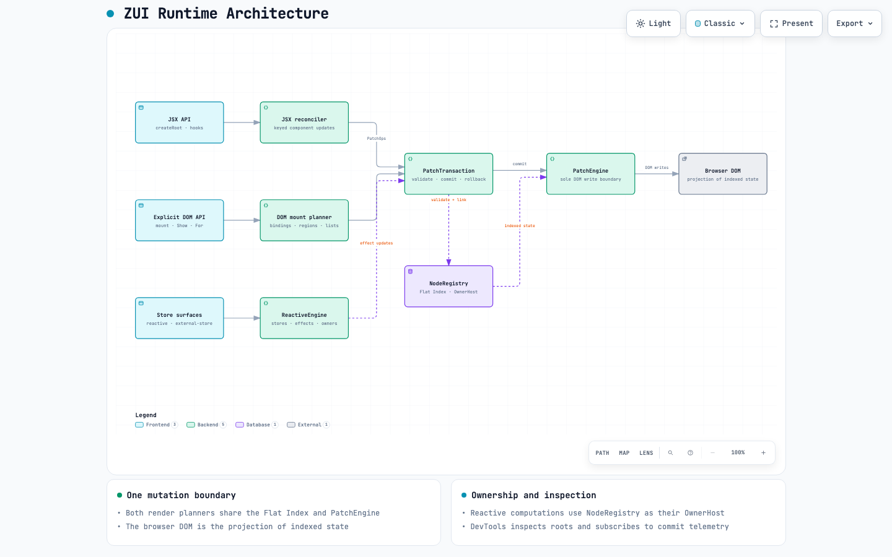
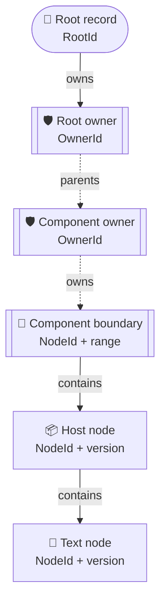
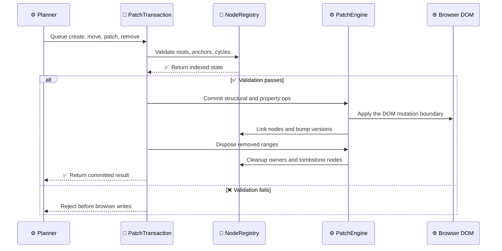
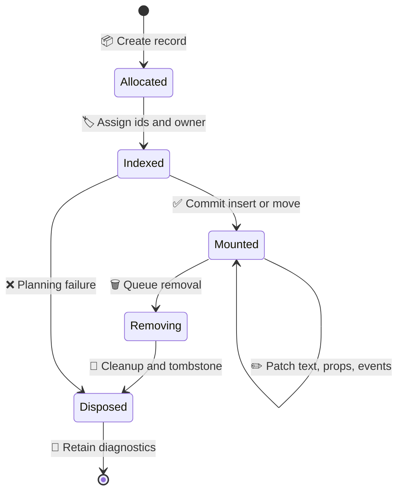

# Addressable DOM architecture

Explore the [interactive architecture, data-flow, transaction, lifecycle, and performance diagrams](diagrams/README.md).

## Core invariant

The Flat Index is the only source of truth for rendered node identity, parent/sibling structure, ownership, and lifecycle. The browser DOM is a projection of that index. Render planners may keep temporary maps while planning a transaction, but they must not retain an authoritative child tree.

The two public planning surfaces are:

- the JSX component runtime in `src/compat.ts`, which reruns a component for hook state updates;
- the explicit reactive DOM surface in `src/dom.ts` (exported as `zui/dom`, with `zui/legacy` as deprecated compatibility alias), which mounts a subtree once and binds reactive text, properties, regions, and list items.

They share the same `NodeRegistry`, `PatchEngine`, DOM operation helpers, and owner host. They are not independent DOM mutation implementations.

## Flat Index records

Each indexed record has:

- monotonic `NodeId`;
- `RootId` and `OwnerId`;
- `version`, incremented on structural, metadata, property, event, and lifecycle changes;
- node kind: root, element, text, comment, or boundary;
- DOM start/end boundary nodes;
- `parentId`, `prevSibling`, `nextSibling`, `firstChild`, and `lastChild`;
- `isSvg` boolean flag indicating whether the record lives within an SVG XML namespace;
- key, type, props/value metadata, listeners, ref, and cleanup state.

Listener maps and style snapshots are allocated only when those features are used, and are released during disposal; plain text nodes do not pay for either structure.

Parent/sibling links are stored in the registry. `children(parentId)` walks those links and checks the index invariants. Components and structural regions use two comment nodes as one addressable boundary record, so their children are still indexed without a second virtual tree.

To eliminate Map hashing overhead during sequential sibling and parent traversals, `NodeRegistry` maintains an unrolled 4-slot node MRU cache (`cacheId0..3`, `cacheNode0..3`) and a 2-slot owner MRU cache (`cacheOwnerId0..1`, `cacheOwner0..1`). Newly created nodes and sequential traversals hit these fast slots directly without traversing internal `Map` hash buckets.

`RootId` and `OwnerId` are never reused. Disposed records remain as tombstones for diagnostics, while active traversals reject disposed records. `nodeRegistry.diagnostics()` exposes real-time counts of active and tombstoned nodes, owners, roots, and capacity bounds to enable continuous memory and leak verification without external profilers.

The registry keeps two related graphs: solid links describe DOM/index structure, while dashed links describe owner nesting. A node can move in the structure graph without changing its stable `NodeId` or its owner.

## Transaction lifecycle

All browser writes go through `PatchEngine`:

1. A planner creates addressable records and queues operations in a `PatchTransaction`.
2. Specialized fast-path commit pipelines optimize the common transaction classes:
   - **Fresh-subtree mounts (`commitCreatedOnly`)**: When a transaction contains only newly created nodes and no removals, validation and DOM writes are fused into a single pass. Monotonic ID range tracking (`nodeId >= startNodeId`) identifies newly created nodes with zero `Set` allocations; duplicate insertion checks use native property checks (`node.parentId !== null`); cycle checks are pruned for leaf nodes (`node.firstChild === null`); and DOM insertions route through `insertCreatedRange` and `linkCreatedChild`, bypassing detached checks (`domStart.parentNode`) and duplicate ancestor cycles.
   - **Text-only updates (`commitTextOnly`)**: Compares directly against cached JavaScript string `node.value` (avoiding native Blink `CharacterData.data` reads) and applies text mutations linearly with inverse rollback recording.
   - **General updates**: Full multi-pass validation checks root membership, node state, parent/anchor validity, cycles, duplicate operations, operation-kind constraints, and unsafe property sinks.
3. Commit inserts or moves ranges, patches text/properties/events/refs, and updates the Flat Index. Only inert initial `data-*`/`aria-*` attributes on detached native elements may be applied earlier through `PatchEngine`.
4. Remove operations run after structural/property changes. The engine clears bindings, runs cleanup, and disposes removed records.
5. Planning failures discard newly created records. Commit failures remove newly inserted ranges where possible and preserve the original exception.

Nested reactive updates join the active transaction for the same root. This is important for initial effects and list item updates: they cannot bypass the transaction boundary or mutate DOM independently.

## JSX runtime lifecycle

`createRoot(container)` creates a root record and root owner. Rendering reads indexed children, matches keyed/type-compatible records, and produces a new ordered list of `NodeId` values only for the current plan. The registry remains authoritative.

- Text changes queue a text patch on the existing `NodeId`.
- Compatible host nodes retain identity and queue property/child patches.
- Compatible components retain their boundary `NodeId` and hook state, then rerun their component function.
- New nodes are created through the transaction and moved into final order by key.
- Removed nodes are disposed after the commit, including descendant effects, listeners, refs, and component cleanups.

Keyed reconciliation reads the current `NodeId` order from the registry. The next child array is a planning result, not a second source-of-truth tree. Several specialized fast paths bypass expensive diffing steps:

- **Leaf primitive text fast path**: In `mountValue`, when an unattached native element's `children` prop is a primitive string or number, the text node is created and attached directly to the parent record without entering `reconcileChildren`, skipping redundant array checks, sibling inspection, and recursive function frames.
- **Exact keyed reversal (`reconcileReversedChildren`)**: Detects exact reversed permutations in $O(N)$ linear time with zero allocations, bypassing Longest Increasing Subsequence (LIS) calculation and scheduling a direct `moveMany` batch.
- **Single-step rotation (`reconcileSingleStepRotation`)**: Detects single element cyclic shifts at the head or tail and emits a single `move` operation.
- **Ordered linear scan (`reconcileOrderedChildren`)**: For identical orders, text updates, and tail insertions/removals, matches nodes in a single linear pass. Matched records are cached during validation to eliminate second-pass registry lookups, and unconsumed tail siblings are removed directly from the cursor.
- **Cached parent propagation**: Recursive JSX descent (`mountValue`, `reconcileChildren`, `reconcileOrderedChildren`) propagates `parentRecord` down the tree, pre-populating `cachedNode` and `cachedParent` on queued insert operations to avoid repetitive Map lookups during commit.
- **Closure-free array normalization**: Child arrays are inspected with an indexed loop and flattened via a static `flattenChild` routine, completely avoiding closure allocations and `Array.prototype.forEach` call frames.

Fresh native host subtrees are assembled while detached, then their root is attached. This reduces incremental writes to a live ancestor during large mounts. Initial `data-*` and `aria-*` attributes on native elements are applied through the patch engine without allocating a property operation; other props still follow transaction validation and commit. Custom elements keep the connected insertion/attribute-callback order because their callbacks are user code. Refs on newly created nodes are invoked after the structural transaction, so they observe the mounted subtree even when a render also updates existing nodes.

For same-parent keyed move batches, validation resolves the original/final order to record arrays once. The DOM move loop consumes those prepared records instead of repeating id-to-record map lookups for each moving node and anchor; the full permutation and anchor checks remain in place.

Hooks are attached to component payloads stored on component records. A state setter addresses the owning component by `NodeId`; it cannot update a disposed record or write during render. Effects are flushed after the root transaction.

## External store integration (`zui/external-store`)

ZUI applications can manage global state outside the component tree through external stores. Rather than relying on a React-like Context tree (which causes cascade re-renders across consumers), `zui/external-store` connects directly to external store APIs using structural typing (`getState`, `subscribe`):

1. **Bound hooks via `create()`**: `create` generates a component hook bound to either a state creator function or an existing vanilla store. It matches the standard Zustand API while invoking ZUI's `useStore` internally.
2. **Fine-grained selector caching**: Components subscribe only to their selected slice. When the store updates, the listener recomputes `selector(nextState)`. If the result passes `equalityFn` (`Object.is` by default, or `shallow`), the component skips reconciliation completely.
3. **Reference stability with `useShallow()`**: For multi-field selections returning objects or arrays, `useShallow` caches the previous reference across calls, preventing reference churn from triggering unnecessary component updates.
4. **Subscription safety**: `useStore` maintains `selectorRef` and `equalityRef` so inline arrow selectors do not trigger re-subscriptions. Upon subscribing, a synchronous check runs immediately to prevent race conditions or stale snapshots between render and effect. When a component boundary unmounts, the subscription unregisters cleanly with PatchEngine disposal.

## Explicit reactive lifecycle

The explicit API uses the same index for mount-once subtrees:

- a store/binding creates an indexed text node plus an owned effect;
- a reactive property creates an owned property effect;
- function children, `Show`, and `For` create boundary records;
- keyed list entries are addressable boundary records and preserve their `NodeId` while moving;
- `current()` updates an item store without recreating the item boundary;
- owners are hosted by `NodeRegistry`, so computation disposal and DOM subtree disposal share owner identity.

Ordinary JavaScript values are still snapshots in the mount-once surface. Use `select`, `derive`, stores, or explicit reactive regions for live values.

## Ownership

`NodeRegistry` provides the owner tree. `ReactiveEngine` accepts an `OwnerHost`; the DOM engine passes the registry as that host, and computation ownership is attached to the same `OwnerId` used by DOM nodes. Standalone reactive-engine tests use an in-memory owner host, which does not participate in a DOM root.

Disposal is idempotent. A removed boundary disposes descendants first, then listeners/refs/effects, then its own owner and index record. Root disposal requires an empty indexed root so callers cannot bypass PatchEngine cleanup. Disposed node records release DOM, props, and component-payload references; a bounded set of lightweight tombstones remains for diagnostics.

## Module structure (`src/flat/`)

The flat addressable DOM engine is decomposed into cohesive, single-responsibility modules under `src/flat/`, while preserving `src/flat.ts` as a 100% backward-compatible public re-export façade:

- **`src/flat.ts`**: Backward-compatible re-export façade pointing to `./flat/index.js`.
- **`src/flat/index.ts`**: Public export barrel for the internal flat DOM engine.
- **`src/flat/types.ts`**: Addressable DOM types, monotonic ID aliases (`NodeId`, `RootId`, `OwnerId`), record structures (`FlatNode`, `FlatOwner`, `RootHandle`, `OwnerHost`), patch operations (`PatchOp`), and diagnostic interfaces.
- **`src/flat/registry.ts`**: `NodeRegistry` as the single authoritative source of truth for node identity, ownership scopes, hierarchical parent/sibling pointers, unrolled multi-slot MRU caches, diagnostic tombstones, and index invariant validation (`assertConsistent`).
- **`src/flat/transaction.ts`**: `PatchTransaction` providing batch planning, monotonic ID tracking, multi-pass validation, specialized commit fast paths (`commitCreatedOnly`, `commitTextOnly`), inverse rollback undo closures, and ref deferral.
- **`src/flat/engine.ts`**: `PatchEngine` as the sole gateway for DOM mutations, enforcing lifecycle boundaries, namespace resolution, and subtree disposal.
- **`src/flat/dom.ts`**: Range extraction (`extractRange`), appending (`appendRange`), and parent/anchor resolution (`parentDom`, `parentAnchor`).
- **`src/flat/properties.ts`**: Normalized property applicators (`setProperty`, `setHtmlProperty`, `setSvgProperty`, `setCustomElementProperty`), inline style diffing (`applyStyle`), attribute reflection (`setAttribute`), and XML/SVG namespace constants.
- **`src/flat/security.ts`**: Sink protection, URL scheme sanitization (`isUnsafeUrlProperty`), and property safety assertions (`validateProperty`).
- **`src/flat/focus.ts`**: Active focus and selection preservation across DOM replacements and sibling moves (`captureFocus`, `captureFocusInRecords`, `captureFocusInChildren`, `restoreFocus`).
- **`src/flat/lis.ts`**: Shared keyed-list diffing algorithms — patience-sorting LIS (`longestIncreasingSubsequencePositions`) and the right-to-left move planner (`planStationaryMoves`) used by both the compat reconciler and the `zui/dom` list renderer.
- **`src/flat/equality.ts`**: Allocation-free shallow equality over own enumerable keys (`shallowEqual`), shared by the compat props bailout and the external-store adapter.

## Module structure (`src/dom/`)

The explicit mount-once reactive DOM surface is decomposed into cohesive, single-responsibility submodules under `src/dom/`, maintaining `src/dom.ts` as a 100% backward-compatible re-export façade:

- **`src/dom.ts`**: Backward-compatible re-export façade pointing to `./dom/index.js`.
- **`src/dom/index.ts`**: Barrel index re-exporting the entire reactive DOM surface.
- **`src/dom/types.ts`**: Core interfaces (`Binding<T>`, `Child`, `VNode`, `Conditional`, `Repetition<T>`, `Scope<T>`) and the `BINDING` brand symbol.
- **`src/dom/bindings.ts`**: Fine-grained reactive bindings (`select`, `derive`), store primitives (`createStore`, `useStore`), reactive evaluation utilities (`isStore`, `isBinding`, `readReactive`, `evaluate`, `stringify`), and computation dispatchers (`computed`, `batch`, `untrack`).
- **`src/dom/control-flow.ts`**: Declarative control flow components (`Show`, `For`, `Fragment`, `jsx`, `jsxs`) and structural predicates (`isConditional`, `isRepetition`).
- **`src/dom/mount.ts`**: Lifecycle and mounting coordinator (`mount`), scope managers (`createScope`, `attachScope`), property renderers (`renderProps`), child dispatchers (`renderChild`, `renderList`), and the `longestIncreasingIds` adapter over the shared LIS in `src/flat/lis.ts`.
- **`src/dom/resource.ts`**: Asynchronous resource store primitive (`resource`, `createResource`) providing fine-grained loading/data/error states, race condition suppression, and zero-VDOM-stack-break `<Show>` integration.

## Module structure (`src/compat/`)

The JSX component runtime and reconciliation engine is decomposed into cohesive submodules under `src/compat/`:

- **`src/compat.ts`**: Backward-compatible re-export façade pointing to `./compat/index.js`.
- **`src/compat/index.ts`**: Public export barrel for the JSX compatibility runtime.
- **`src/compat/types.ts`**: Types for component records, hook states, reconciliation contexts, and portals.
- **`src/compat/state.ts`**: Global singletons (`nodeRegistry`, `patchEngine`, `componentState`, `cleanupState`).
- **`src/compat/hooks.ts`**: Component hooks currently implemented by ZUI (`useState`, `useEffect`, `useRef`, `useMemo`, and `useCallback`).
- **`src/compat/portal.ts`**: `createPortal` implementation integrating out-of-band target roots into the Flat Index.
- **`src/compat/error-boundary.ts`**: `ErrorBoundary` component with transactional savepoints (`savepoint()`, `rollbackTo()`).
- **`src/compat/reconcile.ts`**: Fine-grained component subtree reconciliation and diffing.
- **`src/compat/root.ts`**: Public root mounting APIs (`createRoot`, `render`).

## Files

- `src/flat/`: Addressable DOM modules (`registry.ts`, `transaction.ts`, `engine.ts`, `dom.ts`, `properties.ts`, `security.ts`, `focus.ts`, `lis.ts`, `equality.ts`, `types.ts`, `index.ts`).
- `src/flat.ts`: Re-export façade for backward compatibility.
- `src/compat/`: JSX runtime and reconciliation modules (`types.ts`, `state.ts`, `hooks.ts`, `portal.ts`, `error-boundary.ts`, `reconcile.ts`, `root.ts`, `index.ts`).
- `src/compat.ts`: Re-export façade for JSX runtime.
- `src/dom/`: Explicit reactive DOM modules (`types.ts`, `bindings.ts`, `control-flow.ts`, `mount.ts`, `resource.ts`, `index.ts`).
- `src/dom.ts`: Re-export façade for explicit reactive DOM.
- `src/devtools.ts`: Live Flat Index inspector, node/root serializers, transaction telemetry tracker, and browser HUD overlay.
- `src/reactive.ts`: stores, computed values, effects, batching, resource stores, and owner-host integration.
- `src/jsx-runtime.ts`, `src/jsx-dev-runtime.ts`: automatic JSX transform entries.
- `tests/flat.test.ts`: registry and transaction unit tests.
- `tests/flat-submodules.test.ts`: isolated unit tests for flat submodules.
- `tests/flat-random.test.ts`: seeded keyed randomized consistency checks.
- `tests/dom-submodules.test.ts`: isolated unit tests for reactive DOM submodules.
- `tests/resource.test.ts`: async resource primitive and Show integration tests.
- `tests/devtools.test.ts`: Flat Index serialization, telemetry tracking, and browser HUD tests.
- `tests/lifecycle.test.ts`: repeated disposal and owner/node leak checks.

## Current limitations

- Failed DOM commits run best-effort inverse operations and renderer hook snapshots. This is not a fully atomic transaction: user callbacks can have irreversible side effects, and cleanup failures occur after the commit point.
- DOM property normalization is intentionally scoped and does not yet provide full SVG/custom-element parity.
- The engine uses a singleton registry per module instance and browser `document`; SSR and concurrent server rendering are out of scope.
- No independent DOM writes are allowed outside `PatchEngine`; future features must extend its operation set rather than add renderer-specific mutation helpers.
