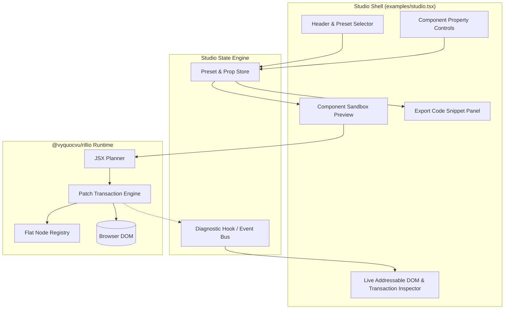

# Architecture Document: Rillio Studio (Interactive Workbench)
## Product: Rillio Studio

### 1. System Architecture Overview
Rillio Studio operates directly on the client side using Vite and the core `@vyquocvu/rillio` library (JSX runtime, hooks, store, and patch engine).

### 2. Module Responsibilities
1. **Studio Shell (`studio.html` & `examples/studio.tsx`)**:
   - Manages workbench layout: top bar with presets, left split pane with property editor and transaction logs, center live preview sandbox, right pane with generated TSX code.
2. **Preset Registry (`examples/studio-presets.ts`)**:
   - Defines declarative component models, configurable props, and initial state configurations.
3. **Telemetry & Transaction Inspector**:
   - Listens to patch cycles and counts mounted nodes, transaction executions, and DOM mutations.
4. **Code Generator**:
   - Formats clean, executable `@vyquocvu/rillio` component code matching current property selections.

### 3. Key Technical Decisions
- **Zero Heavy External Dependencies**: Retain Rillio's pure zero-dependency footprint.
- **Client-Side Reactive Updates**: Changes in the property controls seamlessly trigger reactive re-renders in the preview canvas.
- **Vitest Verification**: All preset generators and studio state stores covered by unit and integration tests.
