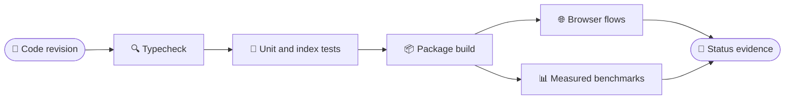

# Testing and MVP acceptance

## Commands

```sh
npm install
npm run typecheck
npm test
npm run build
npm run test:smoke
npm run test:oracle
npm run bench:reactive
npm run bench:compat
npm run test:consumer
npm run bench:flat
npm run bench:browser
npm run test:browser
```

The verification order separates static, runtime, package, browser, and measurement evidence. The final status report records all results against one code revision.



`npm run dev` serves the product showcase at `/` and `/admin.html`. `npm run test:browser` builds the app and package, starts Vite preview, and runs dashboard and runtime smokes in headless Playwright Chromium. Install the browser once with `npx playwright install chromium`. The checks cover metrics, navigation, the controlled member form, table update, runtime errors, cross-API root isolation, rejected HTML/URL/event sinks, and DevTools behavior.

`npm run bench:reactive`, `npm run bench:compat`, and `npm run bench:flat` are exploratory only. They report measured local behavior for reactive invalidation and addressable keyed DOM reconciliation; none should be used to alter preregistered research thresholds or presented as a cross-framework performance claim.

## MVP gates

| ID | Gate | Acceptance |
|---|---|---|
| G1 | Typecheck | `npm run typecheck` exits 0 with strict TS settings |
| G2 | Unit / DOM | `npm test` exits 0; conformance, oracle and jsdom checks |
| G3 | Build | `npm run build` exits 0; showcase, admin, and demos entries verified |
| G4 | Lifecycle | Repeated 100x mount/unmount Show/For/children leaves no retained active effects; event listeners detached |
| G5 | Lists / inputs | Insert, remove, reorder, replace by key, duplicate-key failure; controlled input/checkbox caret/focus sanity |
| G6 | Browser flows | Dashboard metrics, navigation, member form/table update, and no console errors |
| G7 | Consumer package | Built ESM JS + `.d.ts` imported from a separate strict TypeScript/Vite consumer; JSX runtime resolves |
| G8 | Flat Index | Registry structure, transaction validation, seeded randomized updates, and lifecycle disposal remain consistent |

All gates must be recorded against one commit SHA in `docs/STATUS.md`, with environment and commands. Passing older reactive tests **does not** verify newer DOM code.

## Regression coverage and follow-ups

- Follow-up: nested conditional owner disposal during another effect flush; dirty effect disposed before scheduling.
- Follow-up: two independent roots; disposing root A must not affect root B.
- Follow-up: re-entrant writes from `For` item updates and nested event handling.
- Follow-up: keyed moves preserve DOM reference, input focus, text-selection/caret, and event listener.
- Follow-up: form typing with controlled `value` and `checked` remains consistent during flush.
- Follow-up: dynamic branches that throw during creation clean up partially allocated DOM and effects.
- Cross-API root collisions are rejected without orphaning DOM or reactive owners (covered by Vitest and Playwright).
- Failed property commits restore prior DOM/text/refs where inverse operations are possible (covered by Vitest).
- HTML parsing sinks, executable URL schemes, and string-valued event handlers are rejected before any DOM write (covered by Vitest and Playwright).
- Follow-up: CSS style removal and remaining URL-sensitive attributes; untrusted strings should be rendered as text.
- SSR and agent UI security cases deferred until those features exist.

The browser smoke fixture covers state updates, controlled input, focus, keyed DOM identity, caret retention, and uncaught runtime errors. The consumer fixture compiles `tests/consumer-fixture` from a temporary external package directory against generated `dist/package` artifacts.

## Reporting template

```text
Commit SHA:
Date and OS:
Node / npm / TypeScript / browser:
G1 typecheck: PASS | FAIL | NOT RUN
G2 Vitest: PASS | FAIL | NOT RUN  (tests / failed)
G3 Vite build: PASS | FAIL | NOT RUN
G4 lifecycle: PASS | FAIL | NOT RUN
G5 interactions: PASS | FAIL | NOT RUN
G6 E2E: PASS | FAIL | NOT RUN
G7 separate consumer: PASS | FAIL | NOT RUN
Bugs / reproduction / follow-up:
```

Do not modify scientific benchmark thresholds while fixing application bugs. See `research/preregistration.md`.
